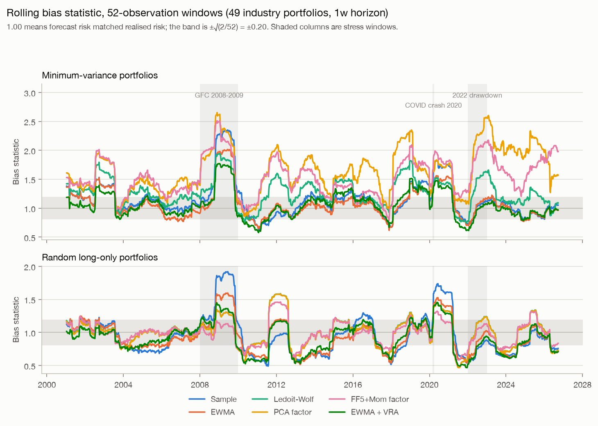

# riskcheck

**How well do standard equity risk models forecast risk out of sample, and where does each one break?**

Six covariance forecasters — sample, exponentially weighted, Ledoit–Wolf shrinkage, a
principal-component factor model, a Fama–French-plus-momentum factor model, and a volatility
regime adjustment — are fit walk-forward on daily data from the Kenneth French Data Library,
with hyperparameters chosen on 1972–1999 and frozen before the 2000–2026 test period is scored
once. The answer is the one practitioners will expect in direction and may not expect in size.
**On random portfolios every model is close to calibrated. On the minimum-variance portfolio each
model builds from its own forecast, every model understates risk** — by 8% for the best and 70%
for the worst over the full test period, and by a factor of five to seven in March 2020. The two
factor models are the worst calibrated *and* deliver the highest realised minimum-variance
volatility, so they lose on both counts. The volatility regime adjustment helps, consistently but
modestly, and — because minimum-variance weights are invariant to scaling the covariance matrix —
it provably cannot change which portfolio you hold, only how much risk you think it has.

## Headline

49 industry portfolios, one-week horizon, 1,345 non-overlapping observations from 2000-01-03 to
2026-09-25. A calibrated model gives a bias statistic of 1.00; the band for the full test period
is ±0.039. "In band" is the share of rolling 52-observation windows within ±0.196 of 1.

| Estimator | Random long-only | Random long-short | Min-variance | Min-var in band | Min-var vol (ann.) | Log score |
| :-- | --: | --: | --: | --: | --: | --: |
| Sample (3y window) | 0.996 | 1.033 | **1.190** | 64% | 11.71% | −6.827 |
| EWMA (half-life 252d) | 0.961 | 0.999 | **1.108** | 72% | **11.40%** | −6.895 |
| Ledoit–Wolf (1y window) | 1.033 | 1.024 | **1.296** | 41% | 11.50% | **−6.903** |
| PCA factor (k=5, 1y) | 1.029 | 1.035 | **1.698** | 13% | 13.01% | −6.816 |
| FF5+Mom factor (1y, factor HL 63d) | 1.009 | 1.007 | **1.591** | 14% | 12.48% | −6.873 |
| EWMA + regime adj. (HL 504d) | 0.941 | 0.985 | **1.082** | 67% | **11.40%** | −6.899 |

Log score is a Gaussian negative log-likelihood per asset, so lower is better. Its *level* is not
comparable across models in any useful way — see [Log score](#log-score-compare-differences-not-levels).

<picture>
  <source media="(prefers-color-scheme: dark)" srcset="results/rolling_bias_dark.png">
  
</picture>

Both panels use the same models and the same dates. The models are not uniformly bad at
forecasting risk; they are bad at forecasting the risk of the portfolios an optimiser builds out
of them.

## Running it

Python 3.11. Every number above is reproduced by this sequence from a clean checkout:

```bash
pip install -e ".[dev]"

riskcheck fetch      # download the French files, record date + SHA-256
riskcheck build      # parse, align, drop gaps, write data/processed/
riskcheck validate   # choose hyperparameters on 1972-1999, freeze to results/
riskcheck evaluate   # score the test span once, write results/
riskcheck report     # print the headline tables
riskcheck bench      # time the walk-forward
```

`validate` and `evaluate` refuse to run out of order: `evaluate` loads its estimator list from
`results/hyperparameters.json` and errors if it is absent, so the test span cannot be scored with
hyperparameters that were never committed to.

`pytest` runs offline on synthetic data; a fixture blocks socket creation for the duration, so a
test that tried to reach Dartmouth would fail rather than make CI depend on a web server.

## Data

[Kenneth R. French — Data Library](https://mba.tuck.dartmouth.edu/pages/faculty/ken.french/data_library.html),
Tuck School of Business at Dartmouth. Daily files, built from CRSP:

| File | Used for |
| :-- | :-- |
| 49 Industry Portfolios (value-weighted) | Asset set A, N = 49 |
| 25 Portfolios formed on Size and Book-to-Market | Asset set B, N = 25 |
| 100 Portfolios formed on Size and Book-to-Market | Large-N case for the compute benchmark only |
| Fama–French 5 Factors (2×3) + RF | Fundamental factor model, excess returns |
| Momentum Factor | Fundamental factor model |

The vintage used here was downloaded 2026-11-25 and built from the 202609 CRSP database, running
to 2026-09-30. `riskcheck fetch` records a SHA-256 for each file in `data/raw/manifest.json` and
`riskcheck evaluate` copies that manifest into `results/run_metadata.json`, because French rebuilds
these files monthly and revises history when CRSP does.

### Why portfolio data and not stock prices

The usual free source of equity history is a price API that only knows about companies that still
exist. Backtesting a risk model on those is not merely noisy, it is biased in the direction that
flatters the model: the firms that blew up are the ones missing, so realised volatility in the
sample is lower than realised volatility actually was. French's portfolios are built from CRSP,
which retains delisted firms and their delisting returns, and a portfolio's return on a given day
includes the constituents that disappeared shortly afterwards. The cost of that choice is set out
in [Limitations](#limitations): these are portfolios, not individual stocks.

### Gaps and what was dropped

The files mark missing data with `-99.99` or `-999` and report returns in percent. Both are handled
explicitly — the markers are stripped before the percent-to-decimal conversion, and the parser
raises rather than continuing if it meets a value below −100% that it does not recognise as a
marker. (Exactly −100% is legitimate and occurs twice in the 100-portfolio file, in 1927 and 1932.)

The panel starts **1969-07-01**, the first date on which all 49 industries have data; the
healthcare series is empty before then. The drop policy is deliberately crude and is recorded in
full in `data/processed/*.json`:

| Asset set | N | Dates | Series dropped | Dates dropped |
| :-- | --: | :-- | :-- | :-- |
| 49 industries | 49 | 14,434 (1969-07-01 → 2026-09-30) | none | 1 (1971-03-11, software missing) |
| 25 size/BM | 25 | 14,435 | none | none |

**The 25 size/book-to-market portfolios are used rather than the 100.** Five of the hundred corner
portfolios are empty on a large share of days even in the test period — `BIG HiBM` is missing on
23% of post-2000 days, and 29% of post-2000 days have at least one missing portfolio. Keeping the
100 would mean deciding which series to drop using full-sample knowledge of *availability*, a mild
but real form of hindsight about the universe. The 25 has no missing values anywhere in the sample,
so that decision never has to be made. The 100 (minus the five sparse corners, N=95) is used only
by `riskcheck bench`, where the question is how long arithmetic takes and the universe choice
cannot affect the answer.

## Estimators

All six forecast the covariance of **daily** excess returns and share two conventions, so the
comparison is like-for-like.

*Second moments, not centred covariances.* Each estimates `E[rr']` rather than
`E[(r−μ)(r−μ)']`. At daily frequency the mean is around 0.03% against a 1.3% standard deviation, so
μ² is about 0.05% of the variance — far smaller than the differences between these estimators — and
leaving it out avoids spending estimation error on a parameter the evaluation does not use. It also
matches the bias statistic, which standardises raw returns.

*Exact exponential normalisation.* The exponentially weighted estimators divide by the realised sum
of weights rather than assuming it has reached `1/(1−λ)`. At a 126-day half-life the truncation
error at the first forecast date is 1.6%, which would show up directly as a calibration miss.

| # | Estimator | Chosen on validation | Searched |
| --: | :-- | :-- | :-- |
| 1 | Sample covariance, rolling window | 3-year window | 1y, 3y |
| 2 | EWMA, RiskMetrics-style | half-life 252 days | 11, 21, 42, 63, 126, 252, 504 |
| 3 | Ledoit–Wolf shrinkage to constant correlation | 1-year window | 1y, 3y |
| 4 | PCA statistical factor model, diagonal specific risk | k = 5, 1-year window | 2 windows × k ∈ {1,2,3,5,8,10} |
| 5 | FF5 + momentum, EWMA factor covariance, diagonal specific risk | 1-year betas, factor half-life 63 days | 2 windows × 5 half-lives |
| 6 | Volatility regime adjustment on the best of the above | on EWMA(252d), half-life 504 days | 21 … 1008 days |

The regime adjustment (6) is the standard practitioner correction: at each past day compute the
cross-sectional bias statistic `B_d = sqrt(mean_i r²_{di} / σ²_{di})`, exponentially average `B²`
over days strictly before the forecast date, and scale the whole matrix by that factor. It uses
only days already owned by an earlier forecast, so the first rebalance date gets a multiplier of
exactly 1.

**The EWMA half-life of 252 days is not a typo.** The RiskMetrics default of λ = 0.94 — an 11-day
half-life — is catastrophic at N = 49, scoring −4.09 on validation against −7.93 for the 252-day
half-life. Eleven days is roughly 16 effective observations for a 49×49 matrix, which is close to
singular. Every grid here was widened until its winner was interior, so no frozen choice is an
artefact of where the grid happened to stop; all 40 configurations and their scores are in
`results/hyperparameters.json`.

## Evaluation

### No look-ahead

Forecasts are refit every 5 trading days after a 756-day burn-in, so the longest window any
estimator may request is exactly available at the first forecast date and every estimator sees the
same forecast dates. Causality is structural rather than checked afterwards: window estimators read
a `dynamic_slice` ending at the forecast date, and the exponentially weighted ones are a forward
`lax.scan` that has only consumed days up to `t` when it emits the forecast for `t`.

`tests/test_no_lookahead.py` replaces every return after a cut date with noise and asserts that all
forecasts at or before the cut are **bit-for-bit identical** — not approximately equal. The
arithmetic for those dates is the same sequence of operations on the same inputs, so anything other
than exact equality is a leak. This runs for all six estimators at four different cut points, and
for the minimum-variance weights derived from them.

### Non-overlapping observations

The conventional band on the bias statistic, `1 ± sqrt(2/T)`, assumes independent observations. The
evaluation grid is built so that it holds: the one-week horizon scores each refit over the
following five days, and the one-month horizon scores every *fourth* refit over the following
twenty, so consecutive observations tile the calendar instead of sliding along it. Scoring a 20-day
horizon weekly would reuse 16 of every 20 days and make the band roughly twice as tight as it
should be.

A daily horizon is also reported. It was not one of the two horizons this project set out to
compare, but it is what makes the stress windows legible: March 2020 contains four non-overlapping
weekly observations and twenty-two daily ones, and a bias statistic on four observations is not
worth printing. Daily observations use the forecast from the most recent refit, so they are up to
four days stale — as a weekly-refit production model would be.

### Why minimum variance is the hard test

Three portfolio sets are scored. Two are fixed random draws made once and reused for every
estimator, date and horizon: 2,000 long-only (flat Dirichlet) and 2,000 dollar-neutral long-short
(unit gross exposure). The third is the fully invested minimum-variance portfolio
`w = Σ̂⁻¹1 / (1'Σ̂⁻¹1)` built from **each model's own forecast**, so every model is asked about the
portfolio it is most confident in.

Random portfolios are easy because they are dominated by the market direction, which every
estimator gets roughly right — and the table confirms it, with all six between 0.94 and 1.04.
Minimum variance is hard for a structural reason: the optimiser puts weight precisely where the
model thinks risk is low, which is disproportionately where estimation error has pushed the
forecast *down*. Errors that average out across random portfolios are selected for. This is not an
artefact of the metric — given the true covariance matrix, the minimum-variance portfolio is as
well calibrated as any other, and `tests/test_bias_statistic.py` asserts exactly that on simulated
data. The test-period result is therefore evidence about estimation error, not about the measure.

### Log score: compare differences, not levels

The Gaussian log score, `log det(hΣ̂) + y'(hΣ̂)⁻¹y` per asset, is a strictly proper scoring rule:
unlike the bias statistic it cannot be improved by inflating the whole matrix, which is why it — and
not the bias statistic — is what hyperparameters were selected on. Intervals come from a block
bootstrap over blocks of about a year, because volatility is persistent enough that resampling
single observations would give intervals several times too narrow.

Each model's own interval is about 0.45 wide, while the gaps between models are all under 0.09.
Read naively that says nothing distinguishes the six. It is the wrong comparison: every estimator
is scored on the *same* realised returns, so almost all of that variation is a common shock.
Differencing against a common baseline removes it and gives intervals an order of magnitude
tighter (49 industries, one-week horizon, baseline Ledoit–Wolf):

| Estimator | Log score | Own 95% interval | vs. best | Paired 95% interval | Worse than best? |
| :-- | --: | --: | --: | --: | :-- |
| Ledoit–Wolf | −6.903 | [−7.12, −6.74] | 0.0000 | — | baseline |
| EWMA + regime adj. | −6.899 | [−7.12, −6.74] | +0.0035 | [−0.0172, +0.0248] | no |
| EWMA | −6.895 | [−7.13, −6.72] | +0.0078 | [−0.0260, +0.0381] | no |
| FF5+Mom factor | −6.873 | [−7.09, −6.70] | +0.0298 | [+0.0184, +0.0439] | **yes** |
| Sample | −6.827 | [−7.08, −6.62] | +0.0754 | [+0.0178, +0.1360] | **yes** |
| PCA factor | −6.816 | [−7.05, −6.63] | +0.0869 | [+0.0613, +0.1211] | **yes** |

So the log score *does* separate the models: a top group of Ledoit–Wolf, EWMA and EWMA+regime
adjustment that are statistically indistinguishable from each other, and three that are reliably
worse. The same three-way split holds on the 25 size/BM portfolios. Full table, both asset sets:
`results/log_score_paired.csv`.

## What each model gets wrong

**Minimum variance, by asset set and horizon** (full table in `results/metrics.csv`):

| Estimator | 49 ind., 1w | 49 ind., 1m | 25 size/BM, 1w | 25 size/BM, 1m |
| :-- | --: | --: | --: | --: |
| Sample | 1.190 | 1.311 | 1.285 | 1.567 |
| EWMA | 1.108 | 1.218 | 1.167 | 1.441 |
| Ledoit–Wolf | 1.296 | 1.398 | 1.340 | 1.636 |
| PCA factor | 1.698 | 1.800 | 1.627 | 2.052 |
| FF5+Mom factor | 1.591 | 1.768 | 1.495 | 1.849 |
| EWMA + regime adj. | **1.082** | **1.195** | **1.128** | **1.390** |

Four patterns, all consistent across both asset sets:

1. **Every model understates minimum-variance risk, always.** Not one of the 24 cells is below 1,
   and not one is inside its band. The direction is systematic, not sampling noise.
2. **The factor models are worst, by a wide margin.** PCA and FF5+Mom sit at 1.5–2.1 and spend
   0–23% of rolling windows in band. Imposing a 5-factor or 6-factor structure on 49 industries
   throws away covariance structure the optimiser then exploits: the model sees no risk in
   directions orthogonal to its factors, so the minimum-variance portfolio loads on exactly those.
   They also produce the *highest* realised minimum-variance volatility (13.01% and 12.48% against
   11.40% for EWMA), so the structure does not buy a better portfolio either.
3. **Longer horizons are worse for everyone.** Every model degrades from one week to one month
   (EWMA 1.108 → 1.218). Scaling a daily covariance by √h assumes returns are independent across
   days; they are not, and the volatility clustering that survives aggregation is not in the
   forecast.
4. **The 25 size/BM portfolios are harder than the 49 industries**, despite having half as many
   assets. They are far more correlated, so the minimum-variance solution takes much larger
   offsetting positions — mean gross leverage 5.21 against 3.26, averaged across the six
   estimators — and leverage amplifies whatever the covariance matrix got wrong. More assets is
   not the thing that makes this problem hard.

**Ledoit–Wolf is the clearest tension in the results.** It wins the log score on the industries and
is 4th of 6 on minimum-variance calibration. Both are correct: shrinkage improves the matrix on
average, which the log score rewards, while leaving the low-variance directions the optimiser
hunts for still mis-estimated. A model can be the best available description of the covariance
matrix and still be badly calibrated for the portfolio you actually hold.

### Did the volatility regime adjustment help?

Yes — consistently, modestly, and not in the way one might hope.

| | 49 ind. 1d | 49 ind. 1w | 49 ind. 1m | 25 1d | 25 1w | 25 1m |
| :-- | --: | --: | --: | --: | --: | --: |
| EWMA | 1.140 | 1.108 | 1.218 | 1.118 | 1.167 | 1.441 |
| EWMA + regime adj. | 1.117 | 1.082 | 1.195 | 1.077 | 1.128 | 1.390 |

It improves minimum-variance calibration in all six cells, by 0.02 to 0.05, and it helps most
exactly where calibration matters most — in the GFC window the minimum-variance bias statistic
falls from 1.613 to 1.412, and in 2022 from 1.181 to 1.085. It is also the best-calibrated model
overall. Three caveats:

- **It cannot change the portfolio.** Minimum-variance weights are invariant to scaling the
  covariance matrix, so multiplying Σ̂ by λ² leaves `w = Σ̂⁻¹1/(1'Σ̂⁻¹1)` exactly unchanged. Realised
  minimum-variance volatility is therefore *identical* to the unadjusted EWMA's, to the last decimal
  place (11.40% and 12.72%), in every cell. The adjustment is a pure calibration fix — it corrects
  how much risk you think you are taking, never how much you are actually taking.
- **It overcorrects elsewhere.** Random long-only bias was already slightly below 1 for EWMA
  (0.961) and the adjustment pushes it further down (0.941). It scales everything, including the
  forecasts that were already right.
- **The validation gain was tiny.** It improved the validation log score from −7.9266 to −7.9290,
  and its advantage on the test span is inside the paired bootstrap interval. The chosen half-life
  of 504 days means the multiplier is nearly a constant — in effect, a slow correction for the
  fact that these models run persistently low, rather than a fast response to regime change.

### Stress windows

Minimum-variance bias statistic, daily horizon, 49 industries:

| Estimator | GFC 2008–09 (n=505) | March 2020 (n=22) | Feb–Apr 2020 (n=52) | 2022 (n=251) |
| :-- | --: | --: | --: | --: |
| Sample | 1.837 | 6.788 | 4.922 | 1.149 |
| EWMA | 1.613 | 5.471 | 4.019 | 1.181 |
| Ledoit–Wolf | 1.550 | 5.702 | 4.173 | 1.492 |
| PCA factor | 2.098 | 6.399 | 4.761 | 2.084 |
| FF5+Mom factor | 1.983 | 5.860 | 4.481 | 2.008 |
| EWMA + regime adj. | **1.412** | **5.162** | **3.790** | **1.085** |

March 2020 is the headline failure: every model understated minimum-variance risk by a factor of
five to seven. No estimator here contains anything that could have done better — all six are
backward-looking functions of trailing returns, and the three weeks to 2020-03-23 had no precedent
in the trailing window. The ranking is nevertheless stable: the regime adjustment is best in all
four windows and the factor models are worst in three of four. 2022 separates the models most
sharply in relative terms — a slow grinding drawdown that the adapting models (1.09–1.18) handled
and the fixed-structure factor models (2.0–2.1) did not.

## Compute benchmark

Apple M-series CPU, float64, JAX 0.10.2. The timed workload is a full walk-forward evaluation: all
six estimators over 2,736 rebalance dates, the quadratic forms for both random portfolio sets, the
minimum-variance solves, and the log scores at all three horizons. Compilation is excluded by a
warm-up pass.

| Assets | Random portfolios per set | CPU best (s) |
| --: | --: | --: |
| 49 | 2,000 | 14.3 |
| 49 | 8,000 | 61.3 |
| 95 | 2,000 | 35.7 |
| 95 | 8,000 | 115.0 |
| 95 | 20,000 | 344.0 |

The complete pipeline — both asset sets, six estimators, three horizons, all tables, the block
bootstraps and both figures — takes **31 s**, and the 40-configuration validation sweep **22 s**.
So the whole study reruns from built panels in under a minute, which is what made it practical to
widen the hyperparameter grids until every winner was interior rather than settling for the first
grid that ran.

Two caveats on these timings, since a laptop is not a benchmarking rig. An early measurement of
the 95-asset, 8,000-portfolio case read 176 s because it shared the machine with a test run, and
was discarded. The 20,000-portfolio case came out at 290 s, 295 s and 344 s on three otherwise
idle runs — a ±9% spread, presumably thermal. Treat the large-N rows as indicative of scaling
rather than precise. Every record ever taken, superseded ones included, is in
`results/bench.json`.

Efficiency was a design constraint rather than an afterthought: the walk-forward is a
chunked `vmap` over rebalance dates rather than a Python loop over 2,736 dates, the exponentially
weighted estimators are a `lax.scan` over 5-day blocks that never materialises a `T×N×N` array, and
the PCA sweep shares one batched `eigh` across all six values of _k_ instead of recomputing it
(1.0 s for six _k_ values against 8.4 s for one, naively).

`notebooks/colab_gpu_benchmark.ipynb` installs this package from the repo on a free Colab T4 and
runs the identical command, in both float64 and float32, across the same problem sizes. Two things
are worth predicting before reading those numbers: consumer NVIDIA cards run float64 at 1/32 of
float32 throughput, and at N=49 this workload is a long sequence of small matrix operations —
a latency problem, which is what a GPU is worst at. The notebook scales N and the portfolio count
up specifically to find where that stops being true.

> **Not yet run.** The GPU column is deliberately absent rather than estimated. Run the notebook and
> paste the table it prints.

## Limitations

- **Portfolios, not individual stocks.** This is the price of avoiding survivorship bias without
  CRSP or WRDS access. Industry and size/BM portfolios are already diversified, so the
  idiosyncratic risk that dominates a single-stock covariance matrix is largely averaged away, and
  the N/T ratio is far gentler than the N ≈ 1000 a real equity risk model faces. Shrinkage and
  factor structure should both look *better* at higher N/T than they do here; these results do not
  say what the ranking would be on stocks.
- **US equities, one market, one currency.** No conclusions transfer to credit, rates, FX, or
  non-US equity without re-running.
- **Daily data, short horizons.** One day to one month. Nothing here speaks to quarterly or annual
  risk forecasting.
- **A fixed set of six estimators.** No DCC or other multivariate GARCH, no non-linear shrinkage
  (Ledoit–Wolf 2017), no Bayesian or hierarchical pooling, no implied volatility. The comparison is
  among common baselines, not a claim about the frontier.
- **Unconstrained minimum variance.** No long-only constraint, turnover penalty, or transaction
  costs. Real mandates constrain weights, and constraints act as implicit regularisation that would
  reduce — not eliminate — the failure documented here. Realised volatility is reported gross.
- **One test period.** 2000–2026 is a single realisation containing three major crises. The
  stress-window numbers in particular rest on few independent episodes, whatever the observation
  counts say.
- **Gaussian log score.** Daily equity returns are fat-tailed, so the score is a proper scoring
  rule for the covariance under a model the data violates. It ranks models consistently; its
  absolute level should not be interpreted.

## Credit and licence

Return and factor data courtesy of the
[Kenneth R. French Data Library](https://mba.tuck.dartmouth.edu/pages/faculty/ken.french/data_library.html),
Tuck School of Business at Dartmouth. The 49 industry portfolios, 25 and 100 size/book-to-market
portfolios, Fama–French 5 research factors and momentum factor are © Eugene F. Fama and Kenneth R.
French and are used here under the library's terms, which ask that the source be credited. This
project is not affiliated with or endorsed by Dartmouth, Professor French or Professor Fama.

Code: MIT, © Oscar Dalton, 2026.
